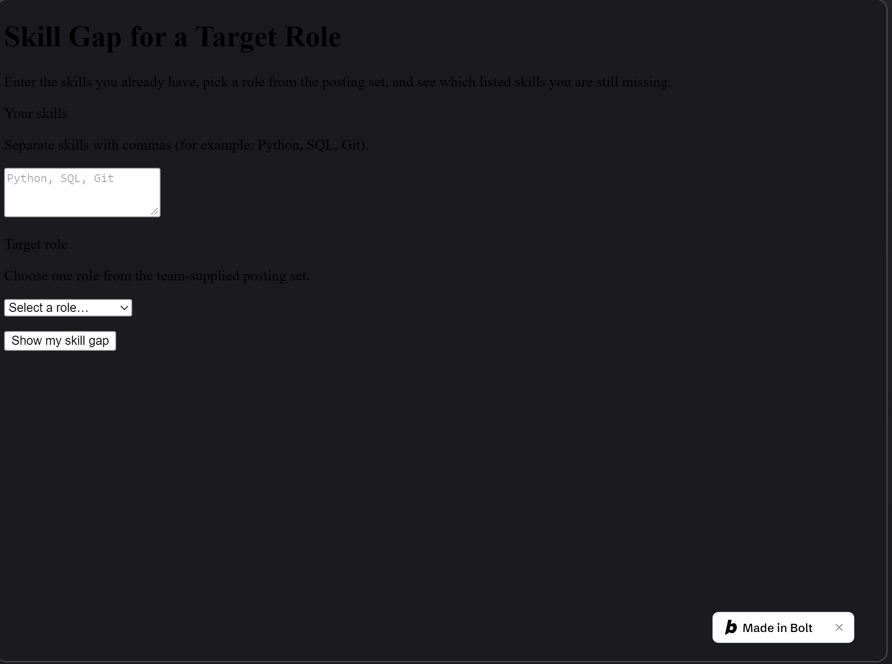
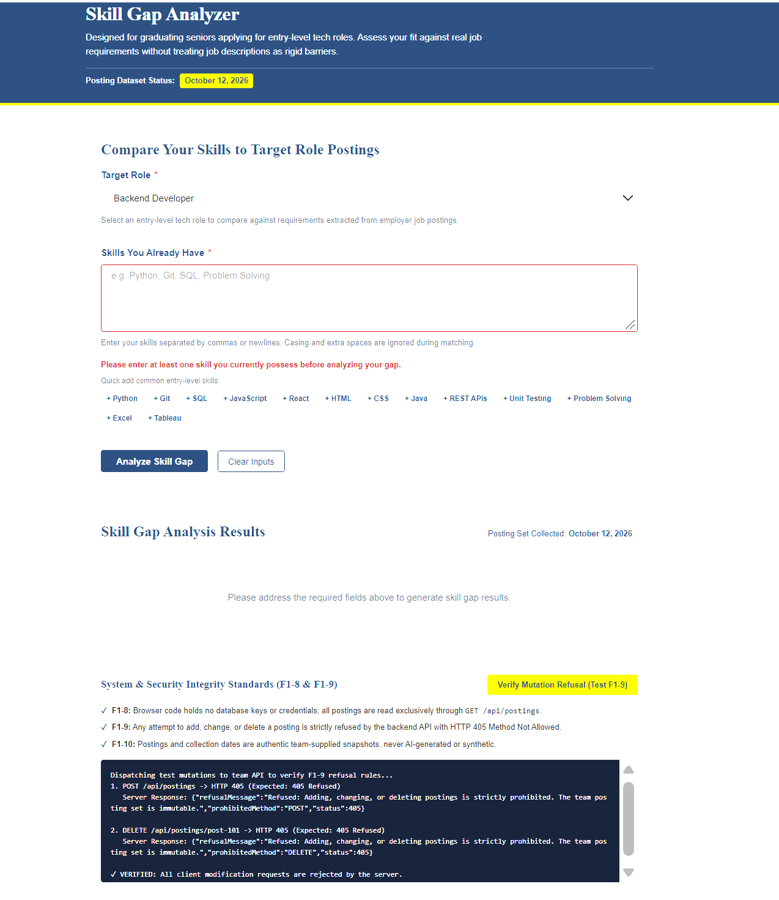

# HW6: Two Builders, One Specification

> Replace every line in angle brackets. A README that still carries template placeholders loses points.

## Feature

**Team repository:** https://github.com/aaronsarasota04/mgt3745-team-gamma
**Spec provenance:** copied from commit `5abbc1c5509800ce9898e9935eafdf94cf694cc0` on 2026-10-08

**Feature:** F1: Show the skills a student is missing for a target role

- 1. THE SYSTEM SHALL let a student enter the skills they already have and choose one target role from the roles in the posting set. (PROBE-001 #3)
- 2. WHEN a student submits skills and a target role, THE SYSTEM SHALL list the skills that appear in postings for that role and are missing from the student's list.
- 3. THE SYSTEM SHALL match skills without regard to capitalization or extra spaces.
- 4. THE SYSTEM SHALL show the date the posting set was collected next to every result, so a student does not read a frozen snapshot as current.
- 5. IF the student enters no skills, THEN THE SYSTEM SHALL ask for at least one skill and SHALL NOT show a result.
- 6. IF the target role has no postings in the data set, THEN THE SYSTEM SHALL say so, naming the role, and SHALL NOT show a gap.
- 7. IF the student already has every skill in the postings for the role, THEN THE SYSTEM SHALL say no gap was found instead of showing an empty list.
- 8. THE SYSTEM SHALL read postings only through the team's own API, and SHALL NOT hold a database key in browser code. (PROBE-001 #1)
- 9. IF a request from the browser tries to add, change, or delete a posting, THEN THE SYSTEM SHALL refuse it. (PROBE-001 #4)
- 10. THE SYSTEM SHALL show only postings and a collection date that the team supplied, and SHALL NOT generate either. (PROBE-001 #2)

## See It Work

| bolt.new | AI Studio |
|---|---|
|  |  |
## Status

Both bolt.new and AI Studio passed all 10 EARS rows in the automated evals. Recommend AI Studio: it scored higher overall (75.7/100 vs. 45.7), while Bolt.new’s screenshot showed an unstyled rendering issue.

## How to Run the Evals
From the repository root, run:
```bash
npm test
```
This runs the shared behavioral tests against both builds in evals/impl—20 tests total, covering 10 EARS rows per build. Expect 20 passing tests and 0 failures. These tests don’t assess visual rendering; see JUDGMENT.md for the visual evaluation.

## Links

- [EVALS.md](EVALS.md): Prediction Stake and error log
- [COMPARISON.md](COMPARISON.md): evidence, spec gaps, and recommendation
- [JUDGMENT.md](JUDGMENT.md): judgment eval and agreement rate
- [prompts/PROMPT.md](prompts/PROMPT.md): the exact input both builders received
- [builds/](builds/): bolt.zip and aistudio.zip
- [docs/DDR-001.md](docs/DDR-001.md) (bolt.new), [docs/DDR-002.md](docs/DDR-002.md) (AI Studio)
- Team pull request or issue: <URL>
- Deployed Worker (only if you completed the proxy step): <URL>

## Hours

5

## AI Use

<Every tool that wrote more than a line or two, each with a link to its DDR.>
